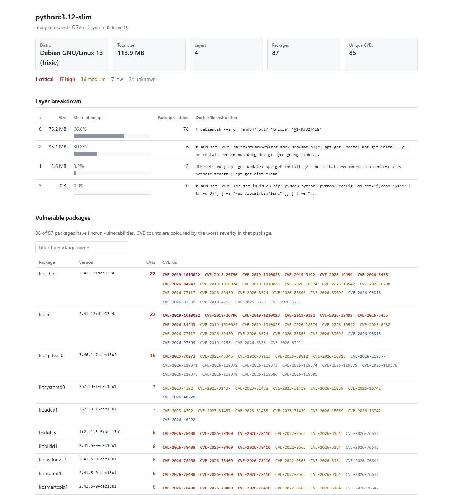

# imagex

imagex inspects a Docker image saved with `docker save` without running it. It lists the OS packages inside, shows which layer (and which Dockerfile instruction) added them, and looks up known vulnerabilities for each package in the [OSV](https://osv.dev) database.

## Install

Requires Python 3.10+.

```bash
python -m venv .venv
source .venv/bin/activate        # Windows: .venv\Scripts\activate
pip install -r requirements.txt
pip install -e .                 # optional: puts an `imagex` command on PATH
```

Without `pip install -e .`, use `python -m imagex` wherever this README says `imagex`.

## Usage

imagex reads image tars. It never pulls from a registry itself.

```bash
docker save python:3.12 -o python312.tar
# or fetch all five test images into ./images/
./scripts/fetch_images.sh

imagex inspect python312.tar                     # full report
imagex inspect python312.tar --no-vulns          # skip the OSV lookup (fast, offline)
imagex inspect python312.tar --all               # list every package, not only vulnerable ones
imagex inspect python312.tar --sbom out.json     # also write the package list as JSON
imagex inspect python312.tar --html report.html  # also write an HTML report

imagex compare images/python_3.12.tar images/python_3.12-slim.tar
imagex compare images/python_3.12.tar images/python_3.12-slim.tar --html diff.html
```

Run the tests:

```bash
python -m unittest discover -s tests
```

## Results

Measured on 2026-11-07 by running `imagex inspect` on each tar (amd64, images pulled that day). CVE counts change daily as advisories are published and images are rebuilt, so expect different numbers when you rerun.

| Image | Base | Size | Packages | CVEs (unique) | Critical / High / Medium / Low / Unknown |
|---|---|---:|---:|---:|---|
| `python:3.12` | Debian 13 | 1.0 GB | 469 | 820 | 31 / 220 / 283 / 34 / 252 |
| `python:3.12-slim` | Debian 13 | 113.9 MB | 87 | 85 | 1 / 17 / 36 / 7 / 24 |
| `node:22` | Debian 12 | 1.1 GB | 413 | 2518 | 109 / 699 / 776 / 39 / 895 |
| `node:22-alpine` | Alpine 3.24 | 160.4 MB | 19 | 1 | 0 / 0 / 0 / 0 / 1 |
| `alpine:3.20` | Alpine 3.20 | 7.4 MB | 14 | 1 | 0 / 1 / 0 / 0 / 0 |

Size is the uncompressed content of all layers (see Limitations). "Packages" counts OS packages only.

What the numbers show:

- **Slim and Alpine variants remove most of the attack surface.** `python:3.12-slim` has 85 CVEs against 820 for `python:3.12`. Most of the full image's packages arrive in a single layer that installs compilers and `-dev` libraries (294 of its 469 packages).
- **Most of `node:22`'s count comes from kernel headers.** `linux-libc-dev` alone accounts for 1980 of the 2518 CVEs. It is the kernel's C headers, used for compiling, and no kernel code from it runs in a container. Without it, `node:22` has 538 CVEs. (`python:3.12` on Debian 13 has a newer kernel header package with 326.)
- **Alpine images have very few packages,** so there is little to match.

## Sample report

[docs/sample-report.html](docs/sample-report.html) is the HTML report for `python:3.12-slim`. Download it and open it in a browser; it is a single file with no external resources.



## How it works

**The image format.** `docker save` writes a tar archive containing:

- `manifest.json`: names the image's config file and lists its layers in order, bottom first.
- A config JSON: image metadata, including `history`, one entry per Dockerfile instruction.
- One tar per layer. Each layer is a filesystem diff: the files that instruction added or changed. Deletions are recorded as "whiteout" files: an empty file named `.wh.<name>` means `<name>` was deleted, and `.wh..wh..opq` means a directory's earlier contents were all replaced.

With Docker's containerd image store (the default in recent Docker Desktop) the tar uses the OCI layout, so layers live under `blobs/sha256/` and are gzip-compressed. imagex reads `manifest.json` in both the classic and the OCI layout, and `tarfile` detects the compression.

**The pipeline.**

1. **Unpack** (`unpack.py`): extract the layers in order into a temp directory. Later layers overwrite earlier ones, and whiteouts delete paths. Only regular files and directories are written (no symlinks, devices or hard links), and paths that would escape the temp directory are refused. Every history entry not marked `empty_layer` is paired with the next layer, which tells us the instruction behind each layer.
2. **Parse packages** (`packages.py`): read `/var/lib/dpkg/status` (Debian/Ubuntu) or `/lib/apk/db/installed` (Alpine). Both are blank-line separated stanzas of `Key: value` lines. Each layer that installs packages writes a fresh copy of that database, so the first layer whose copy lists a package version is the layer that added it.
3. **Vulnerabilities** (`vulns.py`): send `POST /v1/querybatch` to OSV in batches of 100, then `GET /v1/vulns/<id>` for each advisory to read its CVE id and CVSS vector. imagex computes the CVSS 3.1 base score from the vector to get a severity.
4. **Report** (`report.py`, `html_report.py`): rich tables in the terminal, and an optional self-contained HTML file.

**Two details that change the numbers a lot:**

- **Query by source package.** OSV's Debian and Alpine advisories are keyed by *source* package. Asking about the binary package `libssl3` returns nothing, while asking about its source `openssl` returns the real advisories. imagex reads the `Source:` field (dpkg) or `o:` origin (apk) and queries with that.
- **Include the release in the ecosystem.** Plain `Debian` matches advisories for every Debian release. For one openssl version, `Debian` returned 82 advisories and `Debian:12` returned 52. imagex reads `/etc/os-release` and queries `Debian:13`, `Alpine:v3.20` and so on.

**Counting.** "CVEs" means unique CVE ids per image. A CVE in `openssl` that affects both `libssl3` and `openssl` counts once. The per-package table counts CVEs per binary package.

## Comparison with trivy

I scanned the same five tars with trivy 0.76.2 (vulnerability DB updated 2026-11-07), restricted to OS packages (`--pkg-types os`). trivy ran in its official container, because it is not installed locally:

```bash
docker run --rm -v "$PWD/images:/images:ro" aquasec/trivy:0.76.2   image --input /images/node_22.tar --pkg-types os --scanners vuln --format json
```

| Image | imagex unique CVEs | trivy unique IDs | In both | Only imagex | Only trivy |
|---|---:|---:|---:|---:|---:|
| `python:3.12` | 820 | 815 | 791 | 29 | 24 |
| `python:3.12-slim` | 85 | 86 | 82 | 3 | 4 |
| `node:22` | 2518 | 2529 | 2485 | 33 | 44 |
| `node:22-alpine` | 1 | 1 | 1 | 0 | 0 |
| `alpine:3.20` | 1 | 1 | 1 | 0 | 0 |

The totals agree within about 1%, and the Alpine results are identical. The differences:

- **Distro backports are mostly *not* the cause here.** Backports are the usual reason scanners disagree: Debian patches a CVE without changing the upstream version, for example `curl 7.88.1-10+deb12u15`. A scanner that compares the upstream `7.88.1` against NVD version ranges would report every CVE patched since 7.88.1. In this test both tools read Debian's own tracker data, which records the Debian package version that contains each fix. OSV's `DEBIAN-CVE-*` records are generated from the Debian security tracker. So backports are handled by both tools, which is why the counts match. Querying the release-less `Debian` ecosystem would break this: advisories and fixed versions from other Debian releases would match too (82 instead of 52 advisories for one openssl version, see "How it works").
- **Only trivy: Debian `TEMP-*` IDs.** Most trivy-only entries are Debian tracker placeholders such as `TEMP-0000000-0A1CC5` (38 on `libheif` in `node:22`). These are issues that have no CVE id yet. OSV's Debian feed only contains entries with CVE ids.
- **Only imagex: a few dozen unfixed CVEs**, for example 13 recent ImageMagick CVEs, `CVE-2025-8941` (pam) and `CVE-2020-0347` (linux). OSV lists them as affecting every Debian 12/13 version with no fix, and trivy's database is from the same day, so stale data does not explain the gap. I did not establish the exact reason. Most likely the two tools import different subsets of the tracker's statuses.
- **Per-package pairs differ more than unique CVEs** (`node:22`: 4150 package/CVE pairs in imagex, 3998 in trivy). This comes from how each tool maps a source package's advisories onto its binary packages.
- **Severity differs a lot.** trivy prefers the distro's own rating, and Debian rates many issues low. For `node:22`, trivy reports 10 critical and 614 low, while imagex reports 109 critical and 39 low. imagex computes severity from the CVSS v3 vector, which mostly comes from NVD. Many recent CVEs carry only a CVSS v4 vector, which imagex does not score, so they show as `unknown` (895 on `node:22`, mostly kernel CVEs).

## Limitations

- **No backport awareness of its own.** imagex compares the installed version with the version ranges published in OSV. Distros often fix a CVE by patching an old version (a backport), and some CVEs are marked "not affected" or "won't fix" in the distro tracker. imagex only gets that right when the OSV data encodes it, and it ignores the distro's status notes. Results are "known advisories for this version", not proof that something is exploitable.
- **OS packages only.** No language-level dependency scanning: Python packages installed with pip, `node_modules`, Go or Rust binaries, JARs and so on are not inspected. In `python:3.12` and `node:22`, Python and Node themselves are built from source into `/usr/local` and are invisible to imagex.
- **No runtime analysis.** The image is never run, so there are no running processes, open ports or loaded libraries. A vulnerable package is reported whether or not anything uses it.
- **Severity is CVSS-based.** imagex computes severity from the CVSS v3 vector in OSV. Records with only a CVSS v4 vector, or with no vector yet (common for very new CVEs), show as `unknown`. trivy prefers the distro's own rating, so its severity split differs.
- **Single image, single platform.** For a multi-image tar, only the first entry in `manifest.json` is used. Only gzip or uncompressed layers can be read (Python's `tarfile` reads zstd only from Python 3.14).
- **Simplified filesystem.** Symlinks and hard links are not recreated. On Windows, files whose names are invalid there (for example names containing `:`) are skipped, and the count is shown as a warning. Neither affects package detection.
- **Extraction speed.** The whole filesystem is written to a temp directory. On Windows, writing tens of thousands of small files is slow: about 2 minutes for `python:3.12`.
- **Sizes** are the sum of file sizes in each layer (uncompressed content). They do not subtract files that a later layer overwrites or deletes, so they are close to, but not exactly, what `docker images` shows.
